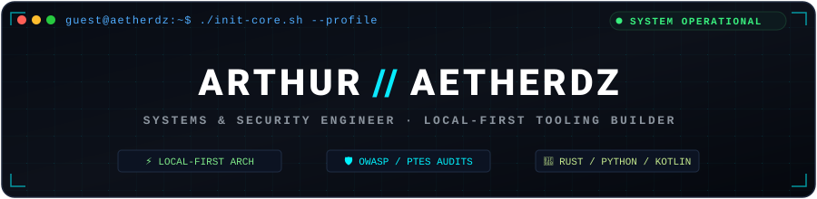
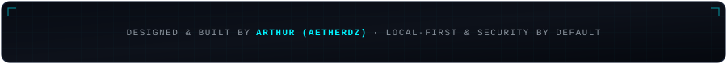

<div align="center">

  <!-- Hero Header Banner (Local SVG - 100% reliable, zero external downtime) -->
  <a href="https://aether-dz.vercel.app">
    
  </a>

  <!-- Dynamic Typing Subtitle -->
  <a href="https://aether-dz.vercel.app">
    
  </a>

  <br/>

  <!-- Status & Telemetry Pill Row -->
  <p>
    
    
    
    
    
  </p>

  <!-- Connect Channels -->
  <p>
    <a href="https://aether-dz.vercel.app" target="_blank">
      
    </a>
    <a href="mailto:arthur_exe@proton.me" target="_blank">
      
    </a>
    <a href="https://t.me/PP9PS" target="_blank">
      
    </a>
    <a href="https://linkedin.com/in/aether-dz" target="_blank">
      
    </a>
    <a href="https://x.com/Aether_Dz" target="_blank">
      
    </a>
  </p>

</div>

---

### ⚡ Core Engineering Philosophy

> *"Local-first by default. Clear trust boundaries. Verified and reproducible evidence. Owned tools."*

```text
┌────────────────────────────────────────────────────────────────────────────────────────┐
│  01. SYSTEMS & LOCAL-FIRST TOOLING                                                     │
│      Building single-binary Rust agents, sub-millisecond cold starts, and owner-only    │
│      local MCP bridges that eliminate reliance on third-party cloud intermediaries.     │
├────────────────────────────────────────────────────────────────────────────────────────┤
│  02. OFFENSIVE & DEFENSIVE SECURITY                                                    │
│      Executing PTES and OWASP methodology assessments across SaaS, web apps, and APIs. │
│      Designing 12-skill bug bounty pipelines with strict proof gates over payload dumps.│
├────────────────────────────────────────────────────────────────────────────────────────┤
│  03. RESILIENT FRONTEND & NATIVE MOBILE                                                │
│      Authoring high-performance Arabic-first Android apps with local media pipelines,   │
│      and zero-backend client-side static generators guaranteeing user data ownership.  │
└────────────────────────────────────────────────────────────────────────────────────────┘
```

---

### 🛡️ Bug Bounty & Offensive Security Specialization

Specializing in **Application Logic Auditing, Authz Boundaries & Multi-Agent Security Automation**. Moving far beyond automated scanner noise into deep target modeling, manual reasoning, and deterministic proof gates:

```text
┌────────────────────────────────────────────────────────────────────────────────────────┐
│  HUNTING METHODOLOGY: RECON → MODEL → HYPOTHESIZE → TEST → VERBATIM PROOF GATE         │
├────────────────────────────────────────────────────────────────────────────────────────┤
│  • Target Modeling: Multi-account actor matrices, tenant boundaries, state machines.   │
│  • High-Value Logic Flaws: IDOR, Broken Object Level Auth (BOLA), Race Conditions, OTP.│
│  • Bug Bounty Multi-Agent OS: Custom architecture of 70+ specialized security skills. │
│  • Proof-Gate Enforcement: Verbatim HTTP evidence & reproducible PoCs; zero noise.    │
└────────────────────────────────────────────────────────────────────────────────────────┘
```

<div align="center">
  <table width="100%">
    <tr>
      <td width="25%" align="center">
        <b>🎯 Logic &amp; Access Control</b><br/>
        <sub>IDOR · BOLA · BAC<br/>Tenant Boundary Isolation<br/>State Machine &amp; Race Flaws</sub>
      </td>
      <td width="25%" align="center">
        <b>🌐 API &amp; GraphQL Auditing</b><br/>
        <sub>Introspection Abuse<br/>JWT Attacks · OAuth Flow<br/>BFLA &amp; Sibling Endpoints</sub>
      </td>
      <td width="25%" align="center">
        <b>🤖 AI / LLM Vulnerabilities</b><br/>
        <sub>Prompt Injection &amp; Evasion<br/>Agent Tool &amp; MCP Abuse<br/>RAG Context Poisoning</sub>
      </td>
      <td width="25%" align="center">
        <b>📋 Standards &amp; Triage</b><br/>
        <sub>CVSS 3.1 Impact Scoring<br/>PTES &amp; OWASP Standards<br/>Sanitized Case Reports</sub>
      </td>
    </tr>
  </table>
</div>

---

### 🛠️ Active Repositories & Flagship Tooling

Dynamic telemetry from my primary open-source projects, local-first bridges, and mobile clients (updated live from GitHub):

<div align="center">
  <table width="100%">
    <tr>
      <td width="50%" align="center">
        <a href="https://github.com/Aetherdz/telecode">
          
        </a>
      </td>
      <td width="50%" align="center">
        <a href="https://github.com/Aetherdz/opencode-mobile">
          
        </a>
      </td>
    </tr>
    <tr>
      <td width="50%" align="center">
        <a href="https://github.com/Aetherdz/VidNest">
          
        </a>
      </td>
      <td width="50%" align="center">
        <a href="https://github.com/Aetherdz/opencode-mobile-dist">
          
        </a>
      </td>
    </tr>
  </table>

  <p align="center">
    <a href="https://aether-dz.vercel.app" target="_blank">
      
    </a>
  </p>
</div>

---

### 💻 Technical Arsenal

#### Languages & Core Runtimes
<p align="left">
  <a href="https://skillicons.dev">
    
  </a>
</p>

#### Frontend & UI Architecture
<p align="left">
  <a href="https://skillicons.dev">
    
  </a>
</p>

#### Security, Systems & Developer Tooling
<p align="left">
  <a href="https://skillicons.dev">
    
  </a>
</p>

#### Standards, Protocols & Security Capabilities
<p align="left">
  
  
  
  
  
  
  
</p>

---

### 📊 GitHub Telemetry & Real-Time Analytics

<div align="center">
  <table width="100%">
    <tr>
      <td width="50%" align="center">
        
      </td>
      <td width="50%" align="center">
        
      </td>
    </tr>
    <tr>
      <td colspan="2" align="center">
        
      </td>
    </tr>
  </table>
</div>

---

### 📡 Direct Dispatch & Communication

Have a security research inquiry, an open-source collaboration, or a systems engineering opportunity? Reach out directly through verified channels:

<div align="center">
  <table>
    <tr>
      <td align="center"><b>Channel</b></td>
      <td align="center"><b>Endpoint</b></td>
      <td align="center"><b>Action</b></td>
    </tr>
    <tr>
      <td align="center">🌐 <b>Live Portfolio</b></td>
      <td><code>https://aether-dz.vercel.app</code></td>
      <td align="center"><a href="https://aether-dz.vercel.app">Explore Showcase →</a></td>
    </tr>
    <tr>
      <td align="center">🔒 <b>Secure Email</b></td>
      <td><code>arthur_exe@proton.me</code></td>
      <td align="center"><a href="mailto:arthur_exe@proton.me">Send Encrypted Dispatch →</a></td>
    </tr>
    <tr>
      <td align="center">💬 <b>Telegram Direct</b></td>
      <td><code>@PP9PS</code></td>
      <td align="center"><a href="https://t.me/PP9PS">Initiate Direct Chat →</a></td>
    </tr>
    <tr>
      <td align="center">💼 <b>LinkedIn</b></td>
      <td><code>linkedin.com/in/aether-dz</code></td>
      <td align="center"><a href="https://linkedin.com/in/aether-dz">Connect Profile →</a></td>
    </tr>
    <tr>
      <td align="center">🐦 <b>X (Twitter)</b></td>
      <td><code>@Aether_Dz</code></td>
      <td align="center"><a href="https://x.com/Aether_Dz">Follow Updates →</a></td>
    </tr>
  </table>

  <br/>

  <!-- Sponsorship / Support -->
  <p>
    <a href="https://ko-fi.com/aetherdz" target="_blank">
      
    </a>
    <a href="https://www.buymeacoffee.com/aetherdz" target="_blank">
      
    </a>
  </p>
</div>

<!-- Footer Terminal Banner -->
<div align="center">
  
</div>
